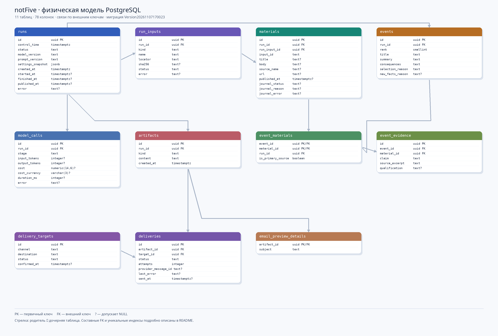

# Физическая модель базы данных notFive

Схема предназначена для запусков анализа публикаций, составления дайджеста, учёта отправки и входа администратора. Основа задана [первой миграцией](../../migrations/Version20261107170023.php), каталог сайтов — миграцией `Version20261108174218`, администраторы — миграцией `Version20261108180308`. Диаграмма ниже показывает основу; добавленные позже таблицы и связь каталога описаны ниже и ещё не нанесены на изображение.

На схеме `PK` означает первичный ключ, `FK` — внешний ключ, `?` — поле, допускающее `NULL`. Все связи направлены от родительской таблицы к дочерней. `doctrine_migration_versions` — служебная таблица Doctrine, в предметную модель не входит.

## Как связаны данные

| Родитель | Дочерняя таблица и ключ | Связь и смысл |
| --- | --- | --- |
| `runs` | `run_inputs.run_id` | 1:N. Один запуск читает набор организаторов или выбранные сайты. |
| `site_sources` | `run_inputs.site_source_id` | 1:N. Один разрешённый сайт может участвовать в нескольких запусках. Для файла и прежних запусков FK пустой. |
| `run_inputs` | `materials.(run_input_id, run_id)` | 1:N. Вход содержит публикации. Составной FK проверяет принадлежность одному запуску. |
| `runs` | `events.run_id` | 1:N. Запуск выбирает до пяти событий. |
| `events` | `event_materials.(event_id, run_id)` | 1:N. У события может быть несколько публикаций. |
| `materials` | `event_materials.(material_id, run_id)` | 1:N. Одна публикация может описывать несколько событий; оба FK в `event_materials` требуют общий `run_id`. |
| `event_materials` | `event_evidence.(event_id, material_id)` | 1:N. У пары «событие — публикация» может быть несколько подтверждаемых фактов. |
| `runs` | `artifacts.run_id` | 1:N. Запуск создаёт готовые файлы: дайджест, пост, письмо, журнал. |
| `artifacts` | `email_preview_details.artifact_id` | 1:0..1. Тема хранится только для предпросмотра письма. |
| `runs` | `model_calls.run_id` | 1:N. У запуска может быть несколько вызовов ИИ. |
| `artifacts` | `deliveries.artifact_id` | 1:N. Один готовый файл отправляют разным адресатам. |
| `delivery_targets` | `deliveries.target_id` | 1:N. Один адресат может получить несколько файлов. |

Итак, связь `events ↔ materials` — многие ко многим через `event_materials`. Связь `artifacts ↔ delivery_targets` — многие ко многим через `deliveries`; в последней хранится состояние каждой конкретной отправки.

`admin_users` пока не связан внешним ключом с запусками: авторизация управляет доступом к GraphQL, а аудит создателя запуска в модель ещё не добавлен. Публичной регистрации нет; команда `admin:bootstrap` после каждой миграции создаёт или восстанавливает учётную запись из секретов окружения. `admin:create` оставлена для ручного добавления других администраторов.

### `admin_users` — доступ администратора

| Поле | Тип | Назначение |
| --- | --- | --- |
| `id` | `uuid PK` | Стабильный ID учётной записи. |
| `username` | `varchar(64)` | Логин из строчных латинских букв, цифр и подчёркивания; уникальный индекс. |
| `password_hash` | `varchar(255)` | Хеш пароля; исходный пароль не сохраняется. |
| `is_active` | `boolean` | При `false` вход и уже выданные JWT перестают работать после проверки пользователя. По умолчанию `true`. |
| `created_at` | `timestamptz` | Время создания учётной записи. По умолчанию текущее время БД. |

## Типы и обязательность

- `uuid` используется для идентификаторов. Значения создаёт приложение: у колонок `id` нет генератора по умолчанию.
- `text` хранит заголовки, тексты, URL, внешние ID и статусы без искусственного ограничения длины. Допустимые статусы ограничены `CHECK`.
- `timestamptz` хранит моменты времени с учётом часового пояса. Окно отбора — `(control_time − 24 часа, control_time]`; пользователю время показывается по Москве.
- `jsonb` применяется только для снимка настроек запуска. Публикации, события и связи остаются в отдельных таблицах.
- `numeric(14,6)` хранит стоимость без ошибок округления типов с плавающей точкой; `varchar(3)` — код валюты.
- `smallint` подходит для позиции события от 1 до 5; `integer` — для счётчиков и миллисекунд; `boolean` — для признака первичного источника.
- `NULL` означает отсутствие или неизвестность значения: например, неподтверждённую дату публикации либо неизвестное число токенов. Это отличается от нуля и пустой строки.

### `runs` — запуск обработки

| Поле | Тип | Назначение |
| --- | --- | --- |
| `id` | `uuid PK` | Идентификатор запуска. |
| `control_time` | `timestamptz` | Конец заданного периода отбора; начало вычисляется вычитанием 24 часов. |
| `status` | `text` | `queued`, `running`, `completed` или `failed`. |
| `model_version` | `text` | Версия модели, выбранная для запуска. |
| `prompt_version` | `text` | Версия инструкций; сами тексты должны быть доступны под этой версией. |
| `settings_snapshot` | `jsonb` | Снимок настроек без секретов; допустим только JSON-объект. |
| `created_at` | `timestamptz` | Время создания; по умолчанию текущее время БД. |
| `started_at` | `timestamptz?` | Начало обработки; отсутствует, пока запуск в очереди. |
| `finished_at` | `timestamptz?` | Завершение или ошибка; не может быть раньше начала. |
| `published_at` | `timestamptz?` | Момент публикации; допустим только при `status = completed`. |
| `error` | `text?` | Причина сбоя всего запуска. |

### `run_inputs` — сайты и контрольный набор

| Поле | Тип | Назначение |
| --- | --- | --- |
| `id` | `uuid PK` | Идентификатор одного входа запуска. |
| `run_id` | `uuid FK` | Запуск, которому принадлежит вход. |
| `kind` | `text` | `site` или `dataset`. |
| `name` | `text` | Читаемое название сайта или набора; пустая строка запрещена. |
| `locator` | `text` | URL сайта или ссылка на сохранённый исходный файл; пустая строка запрещена. |
| `sha256` | `text?` | 64-символьный хеш файла набора; для `dataset` обязателен, для `site` должен быть `NULL`. |
| `status` | `text` | `pending`, `completed` или `failed` для чтения этого входа. |
| `error` | `text?` | Причина ошибки чтения всего входа. |
| `site_source_id` | `uuid? FK` | Выбранный сайт каталога; `NULL` для файла, источников Go по умолчанию и прежних запусков. `name` и `locator` сохраняют значения на момент запуска. |

### `site_sources` — каталог задания

Все 28 адресов из задания внесены со статусом `candidate`. Только проверенные источники со статусом `ready` можно передать в запуск через GraphQL. URL раздела сохраняется для интерфейса и истории, Go получает отдельный корневой домен.

| Поле | Тип | Назначение |
| --- | --- | --- |
| `id` | `uuid PK` | Стабильный ID выбора в API. |
| `name` | `text` | Название источника из задания. |
| `task_url` | `text UNIQUE` | Адрес сайта или раздела из задания. |
| `search_domain` | `text` | Домен для поиска Go, без схемы и пути. |
| `status` | `text` | `candidate`, `ready` или `disabled`; по умолчанию `candidate`. |

### `materials` — исходные публикации и журнал

Одна строка соответствует одной входной публикации. Даже исключённый материал остаётся здесь, чтобы журнал объяснял судьбу каждого ID.

| Поле | Тип | Назначение |
| --- | --- | --- |
| `id` | `uuid PK` | Внутренний ID снимка публикации. |
| `run_id` | `uuid` | Технический ключ запуска для составных FK. Его совпадение с `run_inputs.run_id` проверяет БД. |
| `run_input_id` | `uuid FK` | Сайт или файл, из которого получен материал. |
| `input_id` | `text` | Исходный ID организаторов либо ID, назначенный сборщиком; сохраняет ведущие нули. |
| `title` | `text?` | Исходный заголовок, если был доступен. |
| `body` | `text?` | Извлечённый текст; считается недоверенными входными данными. |
| `source_name` | `text?` | Название издателя из исходной записи. |
| `url` | `text?` | Ссылка из исходной записи. |
| `published_at` | `timestamptz?` | Подтверждённое время публикации; неизвестную дату нельзя заменять временем загрузки. |
| `journal_status` | `text?` | `included`, `merged` или `excluded`; до решения может быть `NULL`. |
| `journal_group` | `text?` | Подпись группы или групп для строки `journal.csv`; появляется после анализа. |
| `journal_reason` | `text?` | Причина отбора, склейки либо исключения; обязательна, когда заполнен статус. |
| `journal_error` | `text?` | Ошибка чтения или обработки именно этой публикации. |

### `events` — выбранные события

| Поле | Тип | Назначение |
| --- | --- | --- |
| `id` | `uuid PK` | Идентификатор события. |
| `run_id` | `uuid FK` | Запуск, выбравший событие. |
| `rank` | `smallint` | Место в дайджесте от 1 до 5, уникальное в запуске. |
| `group_key` | `text?` | ID группы из ответа Go; уникален в пределах запуска, `NULL` для старых событий. |
| `title` | `text` | Нейтральный заголовок события. |
| `summary` | `text` | Краткая суть произошедшего. |
| `consequences` | `text` | Последствия и затронутые системы либо явное отсутствие сведений. |
| `selection_reason` | `text` | Обоснование выбора и порядка. |
| `post_text` | `text?` | Короткий текст этого события для `post.md`; `NULL` у старых выпусков. |
| `new_facts_reason` | `text?` | Новые факты, оправдывающие повторное включение старого события. |

`title`, `summary`, `consequences` и `selection_reason` не могут быть пустыми строками.

### `event_materials` — публикации события

| Поле | Тип | Назначение |
| --- | --- | --- |
| `event_id` | `uuid PK/FK` | Событие. |
| `material_id` | `uuid PK/FK` | Публикация, описывающая событие. |
| `run_id` | `uuid` | Общий запуск, совпадение которого с событием и материалом обеспечивают два составных FK. |
| `is_primary_source` | `boolean` | Найден ли среди входов первичный источник; по умолчанию `false`. |

Первичный ключ — пара `(event_id, material_id)`: повторить эту связь нельзя. `false` означает лишь отсутствие пометки первоисточника, а не доказанную перепечатку.

### `event_evidence` — проверяемые утверждения

| Поле | Тип | Назначение |
| --- | --- | --- |
| `id` | `uuid PK` | Идентификатор записи о факте и его опоре. |
| `event_id` | `uuid FK` | Событие, к которому относится факт. |
| `material_id` | `uuid FK` | Публикация, подтверждающая или уточняющая факт. |
| `claim` | `text` | Конкретное проверяемое утверждение; пустая строка запрещена. |
| `source_excerpt` | `text` | Фрагмент оригинала; пустая строка запрещена. |
| `qualification` | `text?` | Оговорка источника, например «предварительно». |

Составной FK `(event_id, material_id)` допускает доказательство только для уже существующей связи события с публикацией.

### `artifacts` — готовые тексты

| Поле | Тип | Назначение |
| --- | --- | --- |
| `id` | `uuid PK` | Идентификатор готового файла. |
| `run_id` | `uuid FK` | Запуск, сформировавший файл. |
| `kind` | `text` | `digest`, `post`, `email_preview` или `journal`; вид уникален в рамках запуска. |
| `content` | `text` | Сформированный текст для скачивания или отправки. |
| `created_at` | `timestamptz` | Время создания; по умолчанию текущее время БД. |

Symfony собирает четыре представления из сохранённых событий и решений по материалам, затем записывает их в `artifacts.content`. Это нужно, чтобы скачивание и отправка использовали один и тот же сформированный результат. Запрет ручной правки контрольного результата пока должен обеспечить прикладной код: сама таблица допускает `UPDATE`.

### `email_preview_details` — тема письма

| Поле | Тип | Назначение |
| --- | --- | --- |
| `artifact_id` | `uuid PK/FK` | Артефакт предпросмотра письма. |
| `subject` | `text` | Тема письма; пустая строка запрещена. |

Отдельная таблица не создаёт пустого поля `subject` в дайджесте, посте и журнале. БД проверяет существование артефакта, но соответствие его `kind = email_preview` пока должен проверить прикладной код.

### `model_calls` — метрики ИИ

| Поле | Тип | Назначение |
| --- | --- | --- |
| `id` | `uuid PK` | Идентификатор отдельного вызова модели. |
| `run_id` | `uuid FK` | Запуск, совершивший вызов. |
| `stage` | `text` | Этап конвейера, сделавший вызов; пустая строка запрещена. |
| `input_tokens` | `integer?` | Число входных токенов, если известно; неотрицательное. |
| `output_tokens` | `integer?` | Число выходных токенов, если известно; неотрицательное. |
| `cost` | `numeric(14,6)?` | Неотрицательная стоимость, если известна. |
| `cost_currency` | `varchar(3)?` | Трёхбуквенный код валюты; заполняется вместе с `cost`. |
| `duration_ms` | `integer?` | Неотрицательная длительность в миллисекундах, если измерена. |
| `error` | `text?` | Ошибка этого вызова модели. |

`NULL` в метрике значит «нет данных», а `0` — известное нулевое значение.

### `delivery_targets` — получатели

| Поле | Тип | Назначение |
| --- | --- | --- |
| `id` | `uuid PK` | Идентификатор адресата. |
| `channel` | `text` | `email` или `telegram`. |
| `destination` | `text` | Адрес почты или Telegram chat ID; не берётся из текста новости. |
| `status` | `text` | `pending`, `active` или `unsubscribed`. |
| `confirmed_at` | `timestamptz?` | Время подтверждения; обязательно при `active`. |

Пара `(channel, destination)` уникальна. Перед записью email и chat ID должны пройти нормализацию и проверку в приложении.

### `deliveries` — отправки

| Поле | Тип | Назначение |
| --- | --- | --- |
| `id` | `uuid PK` | Идентификатор одной отправки. |
| `artifact_id` | `uuid FK` | Готовый файл, который отправляется. |
| `target_id` | `uuid FK` | Адресат отправки. |
| `status` | `text` | `queued`, `sent` или `failed`. |
| `attempts` | `integer` | Неотрицательное число попыток; по умолчанию `0`. |
| `provider_message_id` | `text?` | ID письма или сообщения у провайдера, если получен. |
| `last_error` | `text?` | Последняя ошибка отправки. |
| `sent_at` | `timestamptz?` | Время успешной отправки; обязательно при `sent`. |

Пара `(artifact_id, target_id)` уникальна, поэтому случайное повторное создание отправки того же файла адресату запрещено.

## Индексы и ограничения

Первичные и уникальные ключи создают индексы автоматически. Отдельно миграция создаёт индексы для основных чтений и внешних ключей:

| Индекс | Для чего |
| --- | --- |
| `runs_published_at_idx` | Список опубликованных выпусков; частичный индекс по ненулевой дате. |
| `run_inputs_run_id_idx` | Входы одного запуска. |
| `run_inputs_site_source_id_idx` | Запуски по выбранному сайту каталога. |
| `site_sources_status_name_idx` | Список сайтов по состоянию и названию. |
| `materials_input_published_at_idx` | Публикации входа по времени. |
| `materials_run_id_idx` | Журнал материалов одного запуска. |
| `event_materials_material_run_idx` | События, связанные с публикацией. |
| `event_evidence_event_material_idx` | Факты по паре события и публикации. |
| `model_calls_run_id_idx` | Метрики вызовов одного запуска. |
| `deliveries_target_status_idx` | Отправки адресата по состоянию. |

Уникальные ограничения дополнительно защищают `(run_input_id, input_id)`, `(run_id, rank)`, `(event_id, material_id)`, `(run_id, kind)`, `(channel, destination)` и `(artifact_id, target_id)`. Уникальные пары `(id, run_id)` в `run_inputs`, `materials` и `events` служат опорой для составных FK и не позволяют связать данные разных запусков.

## Что схема пока не проверяет сама

- Выбор от одного до пяти сайтов и запрет смешивать сайты с файлом в одном запуске. Это правило нужно реализовать при создании запуска; обычный `CHECK` не считает строки другой таблицы.
- Непрерывность рангов 1, 2, 3…; БД ограничивает диапазон 1–5 и уникальность мест.
- Что `email_preview_details` ссылается именно на артефакт `email_preview`, а отправляемый файл соответствует каналу адресата.
- Достоверность фактов, лимиты текста и неизменность контрольного результата после формирования. Эти проверки относятся к конвейеру и экспорту.

Миграция содержит `up()` и обратный `down()`. При удалении таблиц используются обычные внешние ключи без `CASCADE`, чтобы порядок и зависимости оставались явными.
